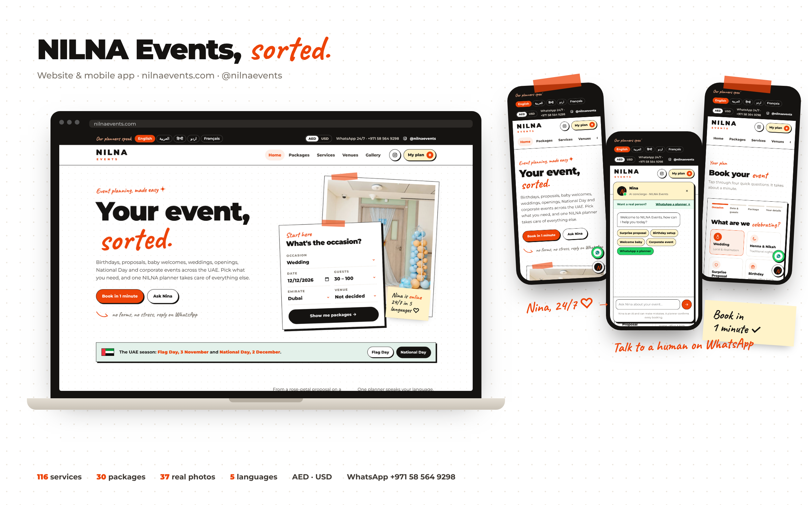

# NILNA Events

Event planning and decoration in Dubai and across the UAE: birthdays, baby welcomes, surprise proposals, weddings, openings, malls, UAE National Day and Flag Day, and corporate events.

**Live site:** https://abbaoumarma-code.github.io/nilna-events/

## What's here

| Folder | What it is |
| --- | --- |
| `/` (`index.html`, `ig/`) | The website, served by GitHub Pages. One HTML file plus the Instagram gallery photos. |
| `/app` | The React Native (Expo) mobile app for iPhone and Android, plus a small server for Nina's live AI and central bookings. See `app/README.md`. |

## Website features

- One-minute booking (4 taps) that sends the full plan to NILNA on WhatsApp (+971 58 564 9298)
- Nina, the event assistant, with a "WhatsApp a planner" handoff
- 116 services, 30 packages, visual venue tour, seating styles
- Gallery of 37 real NILNA photos from [@nilnaevents](https://www.instagram.com/nilnaevents/)
- Languages (English, Arabic, Hindi, Urdu, French) and AED / USD

On GitHub Pages, Nina uses her built-in answers. Live AI answers and the central bookings dashboard need the server in `app/server`.

## Update the site

Edit `index.html` (or replace photos in `ig/`), commit and push to `main`. GitHub Pages republishes in about a minute.
